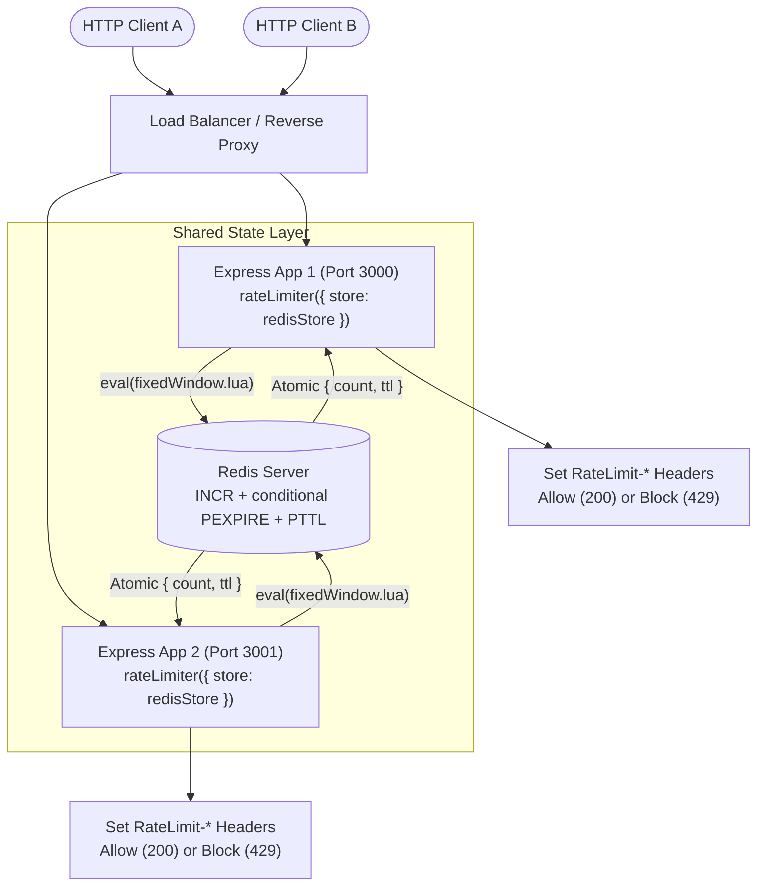
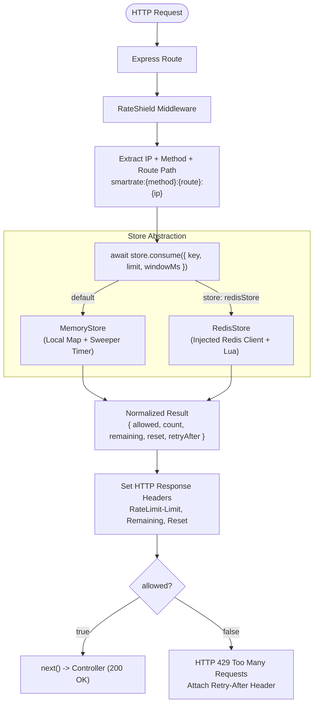

# RateShield

A distributed, atomic rate-limiting middleware for Express.js powered by Redis and Lua scripts. RateShield provides exact quota enforcement across multi-instance clusters with zero race conditions, plus a lightweight in-memory fallback for single-node development.

```javascript
import express from 'express';
import { rateLimiter } from './src/index.js';

const app = express();

// Zero-config: defaults to local in-memory store
app.post(
  '/api/login',
  rateLimiter({ limit: 5, windowMs: 60_000 }),
  loginController
);
```

---

## Architecture

RateShield decouples the Express HTTP layer from quota state management via a pluggable store engine.

### Distributed Multi-Instance Architecture

In clustered environments, multiple Express application instances share a synchronized rate-limit state in Redis. State updates execute through an atomic Lua script directly inside Redis, preventing concurrency race conditions and key expiration leaks.



### Request Lifecycle



---

## Features

- **Dual Storage Engines**:
  - `MemoryStore`: In-memory storage backed by JavaScript `Map` with an unref'd background sweeper for automatic TTL cleanup without blocking the Node.js event loop.
  - `RedisStore`: Distributed shared state across horizontal application instances with native Redis TTL.
- **Atomic Lua Execution**: Executes state transitions (`INCR` -> conditional `PEXPIRE` -> `PTTL`) in a single network round-trip, eliminating race conditions and orphan zombie keys.
- **Dependency Injection**: `RedisStore` receives a pre-connected Redis client, allowing applications full ownership over connection pooling and graceful shutdown.
- **Strict Method & Route Isolation**: Distinct buckets for different HTTP methods on identical routes (`GET /api/users` vs `POST /api/users`).
- **Query Stripping**: Automatically normalizes route paths so query strings share the same quota bucket.
- **Fail-Fast Configuration**: Immediate validation on startup for invalid limits or window durations.
- **RFC 6585 Compliance**: Attaches `RateLimit-Limit`, `RateLimit-Remaining`, `RateLimit-Reset`, and dynamic `Retry-After` headers.

---

## Storage Engines Comparison

| Feature | `MemoryStore` | `RedisStore` |
| :--- | :--- | :--- |
| **State Location** | Process memory (`Map`) | Shared Redis instance / cluster |
| **Dependencies** | None (zero external dependencies) | `redis` client |
| **Multi-Instance Support**| No (isolated to single process) | Yes (synchronized across all nodes) |
| **Key Expiration** | Background interval sweeper (`timer.unref()`) | Native Redis `PEXPIRE` / TTL |
| **Process Restart** | Resets on restart | Persists across application restarts |
| **Primary Use Case** | Local development, testing, single-node apps | Production clusters, containerized deployments |

---

## Usage

### 1. In-Memory Mode (Single Node / Local)

```javascript
import express from 'express';
import { rateLimiter } from './src/index.js';

const app = express();

app.get(
  '/api/public',
  rateLimiter({ limit: 10, windowMs: 60_000 }),
  (req, res) => res.json({ success: true })
);
```

### 2. Distributed Redis Mode (Multi-Instance)

```javascript
import express from 'express';
import { createClient } from 'redis';
import { rateLimiter, RedisStore } from './src/index.js';

const app = express();

const redisClient = createClient({
  url: process.env.REDIS_URL || 'redis://localhost:6379'
});
await redisClient.connect();

const store = new RedisStore({ client: redisClient });

const limiter = rateLimiter({
  limit: 5,
  windowMs: 60_000,
  store
});

app.post('/api/login', limiter, (req, res) => {
  res.json({ success: true });
});
```

---

## Technical Deep Dive: Atomic Redis Lua Scripting

### The Multi-Command Flaw (Non-Atomic Approach)

In standard implementations, the application issues separate sequential commands:

```text
Node.js                      Redis
  │   1. INCR key              │
  ├───────────────────────────>│ (count = 1)
  │                            │
  │   2. PEXPIRE key windowMs  │  <-- Crash or connection drop here creates
  ├───────────────────────────>│      a key with NO TTL ("zombie key")
  │                            │
  │   3. PTTL key              │
  ├───────────────────────────>│
```

This causes two major issues:
1. **Zombie Keys**: A crash between `INCR` and `PEXPIRE` leaves a persistent key with `TTL = -1`, permanently blocking the client.
2. **Race Conditions**: Concurrent requests from different instances interleave, leading to skewed TTL values and inaccurate limits.

### RateShield Lua Solution

RateShield packages the entire state transition into [`src/scripts/fixedWindow.lua`](file:///d:/Desktop/WEB%20DEVELOPMENT/rateshield/src/scripts/fixedWindow.lua):

```lua
local count = redis.call("INCR", KEYS[1])
if count == 1 then
    redis.call("PEXPIRE", KEYS[1], ARGV[1])
end
local ttl = redis.call("PTTL", KEYS[1])
return {count, ttl}
```

- **Single Round-Trip**: Combines 3 Redis calls into 1 network hop, reducing round-trip latency by ~66%.
- **Zero Interleaving**: Redis executes Lua scripts as an atomic unit, preventing race conditions under concurrent burst traffic.
- **Guaranteed Expiry**: `PEXPIRE` executes immediately when the key is initialized (`count == 1`), eliminating unexpiring keys.

---

## Response Headers

Every rate-limited route attaches standard HTTP rate-limiting headers:

| Header | Example | Description |
| :--- | :--- | :--- |
| `RateLimit-Limit` | `5` | Maximum request quota within the active window |
| `RateLimit-Remaining` | `3` | Remaining requests allowed in this window |
| `RateLimit-Reset` | `42` | Seconds remaining until the active window resets |
| `Retry-After` | `42` | *(On HTTP 429)* Seconds client must wait before retrying |

### Example Blocked Response (HTTP 429)

```http
HTTP/1.1 429 Too Many Requests
Content-Type: application/json; charset=utf-8
RateLimit-Limit: 5
RateLimit-Remaining: 0
RateLimit-Reset: 35
Retry-After: 35

{
  "success": false,
  "message": "Too many requests",
  "retryAfter": 35
}
```

---

## Quick Start with Docker

You can test the distributed multi-instance setup locally using Docker Compose:

```bash
docker compose up
```

This starts:
- **Redis Server** on `localhost:6379`
- **Instance A** on `http://localhost:3000`
- **Instance B** on `http://localhost:3001`

Both Express instances share the exact same rate-limit quota across `GET /api/resource`.

---

## Running the Demo (Manual)

```bash
# Ensure local Redis is running (default: redis://localhost:6379)
node examples/express-demo/multi-instance.js
```

---

## Testing

RateShield includes an automated test suite verifying unit logic, memory cleanup, Redis integration, and parallel concurrency bursts:

```bash
npm test
```

### Test Coverage Highlights
- **Concurrency & Atomicity**: 50 simultaneous parallel requests via `Promise.all` verifying exact boundary enforcement (10 allowed, 40 blocked).
- **Multi-Instance Sync**: Validates shared counter state across two separate Express apps sharing one Redis instance.
- **Fail-Fast Validation**: Asserts edge-case input guards (`limit <= 0`, non-integer, invalid store).
- **Memory Sweeper**: Verifies unref'd timer eviction of stale records.

---

## Roadmap

- [ ] Sliding Window Counter & Token Bucket algorithms
- [ ] Custom key extractors (API keys, user IDs, JWT claims)
- [ ] Dynamic parameterized route grouping (`/users/:id`)
- [ ] Configurable fail-open circuit breaker for Redis outages
- [ ] Prometheus metrics exporter
