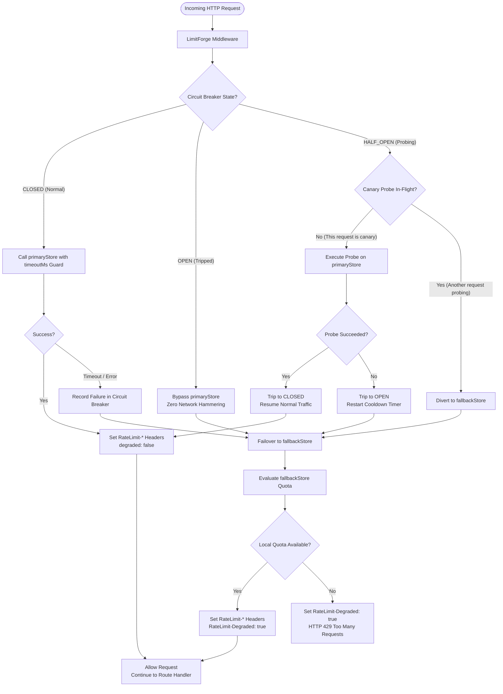

# Resilience & Failure Handling

When a remote rate-limit store becomes slow, unreachable, or partitioned, LimitForge isolates the failure path through four composable layers:

1. **Store Timeout Guard** (`timeoutMs`)
2. **Configurable Failure Policies** (`onStoreError`)
3. **Circuit Breaker** (`CircuitBreaker`)
4. **Dual-Store Failover** (`ResilientStore`)

## 1. Resilience Overview



## 2. Store Timeout Guard (`timeoutMs`)

- Middleware store operations enforce a `250ms` default timeout. On `ResilientStore`, configure `timeoutMs` on the store instance itself (`250ms` default, applied independently to the primary call and the fallback call).
- When the deadline expires, `withTimeout()` clears its timer cleanly on settlement and rejects with `StoreTimeoutError` (`ERR_STORE_TIMEOUT`). Underlying async operations (or synchronous CPU-bound blocks) are not cancelled and may still resolve after the timeout; configure `disableOfflineQueue: true` and socket connect timeouts on your Redis client to prevent stale queued replays after reconnect.
- Where strict global quota consistency outweighs availability, set `onStoreError: 'fail-closed'` so primary timeouts/errors return `HTTP 503` instead of falling back locally.

```javascript
import { rateLimiter, RedisStore } from 'limitforge';

const limiter = rateLimiter({
  store: new RedisStore({ client: redisClient }),
  timeoutMs: 100,
  limit: 100,
  windowMs: 60000
});
```

## 3. Store Failure Policies (`onStoreError`)

`onStoreError` (alias: `failStrategy`) controls what happens when a standalone store fails or when both primary and fallback fail. Under `ResilientStore`, `'fail-closed'` bypasses fallback and rejects immediately on primary failure:

| Policy | Behavior | HTTP Status | Response Header | Typical Use Case |
| :--- | :--- | :---: | :--- | :--- |
| `'error'` *(default)* | Invokes `next(err)` for Express error middleware | App-defined | `RateLimit-Degraded: true` | Explicit error handling / alerting |
| `'fail-open'` | Allows request through (`next()`) | Downstream | `RateLimit-Degraded: true` | Availability over strict quota |
| `'fail-closed'` | Rejects request with `Retry-After` (30s or breaker cooldown) | `503` | `RateLimit-Degraded: true`, `Retry-After` | Protecting expensive endpoints |
| Custom function | Calls `(err, req, res, next)` | Custom | `RateLimit-Degraded: true` | Custom logging or fallback routing |

## 4. Circuit Breaker (`CircuitBreaker`)

`CircuitBreaker` prevents repeated socket timeouts against a degraded store using a three-state FSM:

```text
    ┌──────────────────────────────────────────────┐
    │                                              │
    ▼                                              │
┌────────┐   consecutive failures >= threshold   ┌──────┐
│ CLOSED │ ────────────────────────────────────> │ OPEN │
└────────┘                                       └──────┘
    ▲                                               │
    │ successThreshold met                          │ resetTimeoutMs elapsed
    │                                               ▼
    │                                       ┌───────────┐
    └────────────────────────────────────── │ HALF_OPEN │
               probe failed                 └───────────┘
```

1. **`CLOSED`**: Requests execute directly against the primary store. Failures reset when a call succeeds.
2. **`OPEN`**: After `failureThreshold` consecutive failures (default: `5`), calls short-circuit immediately with `CircuitBreakerOpenError` for `resetTimeoutMs` (default: `10000` ms).
3. **`HALF_OPEN`**: Once `resetTimeoutMs` elapses, the next incoming request executes as a **single-flight canary probe**. After `successThreshold` successful probes (default: `1`), the breaker resets to `CLOSED`; failure re-trips to `OPEN`. Concurrent requests arriving while a probe is in flight skip the primary store—`ResilientStore` routes them to `fallbackStore`, while standalone limiters pass `CircuitBreakerOpenError` to `onStoreError`.

State expiration is evaluated lazily on incoming calls rather than polling with background timers.

## 5. Dual-Store Failover (`ResilientStore`)

`ResilientStore` pairs a distributed primary store (`RedisStore`) with a local fallback (`MemoryStore` by default):

```javascript
import { createClient } from 'redis';
import { rateLimiter, RedisStore, MemoryStore, ResilientStore } from 'limitforge';

const redisClient = createClient({ url: 'redis://localhost:6379' });
await redisClient.connect();

const resilientStore = new ResilientStore({
  primaryStore: new RedisStore({ client: redisClient }),
  fallbackStore: new MemoryStore(),
  timeoutMs: 150,
  failureThreshold: 3,
  resetTimeoutMs: 15000
});

app.use(rateLimiter({
  store: resilientStore,
  limit: 100,
  windowMs: 60000
}));
```

### Degraded Request Metadata

When a request enters fallback or triggers an unhandled store failure:
- `RateLimit-Degraded: true` is added to the response headers.
- `limitforge_degraded_requests_total` is incremented when metrics are enabled.
- `req.rateLimit` is populated for downstream handlers (`undefined` on normal requests):
  - **Fallback used (`ResilientStore`)**: `{ degraded: true, fallbackUsed: true, store: 'fallback', primaryError: '<ErrorName>' }`
  - **Store error policy (`onStoreError`)**: `{ degraded: true, storeError }` (the caught `Error` object)

```javascript
app.get('/api/resource', (req, res) => {
  if (req.rateLimit?.degraded) {
    const reason = req.rateLimit.storeError?.message || req.rateLimit.primaryError;
    console.warn(`Serving degraded request: ${reason}`);
  }
  res.json({ data: 'resource' });
});
```
